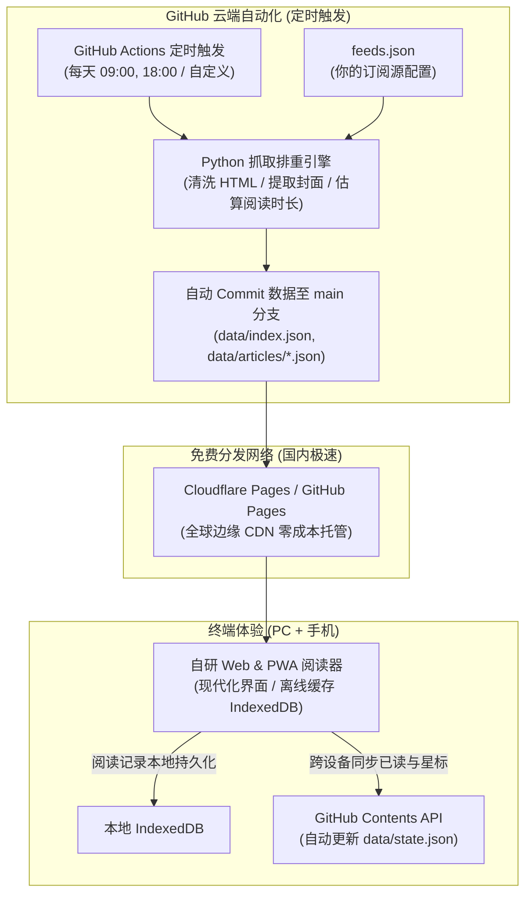

<div align="center">

# ⚡ GitFeed

**以单个 Git 仓库作为完整后端与数据库的开源无服务器 RSS 阅读系统**

[](LICENSE)
[](.github/workflows/update-feeds.yml)
[](https://github.com/codeusb/gitfeed/releases/latest)
[](web/)
[](#)

[English](README_EN.md) | **简体中文**

</div>

---

## 🌟 为什么选择 GitFeed？

传统自建 RSS 服务（如 FreshRSS、Miniflux、Tiny Tiny RSS）通常需要自费购买云服务器、配置 Docker 容器、维护 PostgreSQL 数据库，不仅有持续的服务器成本，而且服务器一旦部署在国内就抓不到海外 RSS，部署在海外国内手机又连不上。

**GitFeed 采用全套优雅的 “Git-as-Backend” 无服务器架构：**

* 🚀 **0 元全套成本**：无需购买任何云服务器、无需额外付费数据库，单个 GitHub 仓库承载全套抓取、数据存储与前端部署。
* 🌐 **海外源云端极速抓取**：由 GitHub Actions 海外 Runner（微软 Azure 优质机房）定时抓取 Substack、Changelog、Medium、GitHub Blog 等，彻底解决国内网络超时甚至被阻断的痛点。
* 📱 **全平台原生级 PWA 客户端**：一次部署，PC（Mac/Windows）与移动端（iOS/Android）直接在浏览器中点击“添加到主屏幕”，秒变独立全屏原生 App。
* ⚡ **国内秒开加速**：前端和文章 JSON 数据通过 **Cloudflare Pages / GitHub Pages** 全球 CDN 分发，国内直连毫秒级响应。
* 🔄 **多端已读同步 (Git-as-Backend)**：客户端本地优先（IndexedDB），配合 GitHub Contents REST API 自动合并增量已读与星标状态，多端无缝协同且永不丢数据。
* 🛠️ **极简维护**：作为使用者，**你只需要维护一个 `feeds.json` 订阅列表**，剩下的所有事情全部由云端自动化完成！

---

## 🏗️ 整体架构流程



---

## 🚀 开箱即用：基于本项目的完整使用指南 (从 Fork 开始搭建)

无需购买服务器、无需配置数据库，只需按以下步骤 Fork 本项目，约 3 分钟即可拥有属于你个人的专属私有全平台 RSS 服务！

### 第一步：Fork 本仓库
1. 点击本仓库页面右上角的 **`Fork`** 按钮。
2. 在弹出的页面中，选择你的个人 GitHub 账号，保持仓库名为 `gitfeed`（或者你喜欢的名字），点击 **Create fork**。

### 第二步：激活 GitHub Actions 自动化工作流
> [!IMPORTANT]
> GitHub 默认对所有 Fork 出的仓库禁用自动化 Actions。因此必须手动激活一次。

1. 进入你 Fork 后的仓库，点击顶部的 **Actions** 标签页。
2. 会看到提示页面，点击绿色的 **“I understand my workflows, go ahead and enable them”** 按钮。

### 第三步：配置 Actions 仓库读写权限
因为 GitHub Actions 需要定时将抓取清洗后的文章与状态提交回你的仓库，请开启写入权限：
1. 进入仓库的 **Settings** -> 左侧导航选择 **Actions** -> **General**。
2. 滚动到底部的 **Workflow permissions** 区域。
3. 选择 **Read and write permissions**（读写权限）。
4. 勾选 **Allow GitHub Actions to create and approve pull requests**。
5. 点击 **Save** 保存。

### 第四步：启用 GitHub Pages 免费托管
1. 点击仓库的 **Settings** -> 左侧导航选择 **Pages**。
2. 在 **Build and deployment** 下方的 **Source** 下拉框中，选择 **`GitHub Actions`**。
   *(注意：不要选择 Deploy from a branch，直接选 GitHub Actions 即可)*。

### 第五步：手动触发首次抓取与部署
1. 点击仓库顶部的 **Actions** 标签页。
2. 在左侧工作流列表中点击 **`Update Feeds & Deploy`**。
3. 在右侧点击 **`Run workflow`** 下拉按钮 -> 保持 `Branch: main` -> 点击绿色的 **Run workflow**。
4. 等待约 1~2 分钟，该工作流会自动抓取预设 RSS、清洗生成静态 JSON 并完成 GitHub Pages 部署。
5. 部署完成后，访问你的专属地址：
   ```
   https://<你的GitHub用户名>.github.io/gitfeed/
   ```
   你的专属私有云 RSS 阅读器就已经正式上线！后续每天由 GitHub Actions 自动定时静默更新。

---

### 第六步：双端无缝同步配置 (PC Web + 手机客户端)

GitFeed 采用本地优先（Local-First）机制，即使不配 Token 也能在单设备完美离线阅读。如果需要在 **电脑网页端** 与 **手机端（Android APK / iOS PWA）** 之间无缝实时同步已读与星标状态：

1. **生成 GitHub 访问令牌 (Personal Access Token)**：
   * 打开 GitHub -> 点击右上角头像 -> **Settings** -> 左侧最底部 **Developer settings** -> **Personal access tokens** -> **Fine-grained tokens**。
   * 点击 **Generate new token**：
     * **Token name**：填入 `gitfeed-sync`（任意名字）；
     * **Repository access**：选择 **Only select repositories** -> 选择你的 `gitfeed` 仓库；
     * **Permissions**：展开 **Repository permissions**，找到 **Contents**，设为 **Read and write**；
   * 点击底部 **Generate token**，复制生成的 `github_pat_...` 令牌字符串。
2. **在客户端配置同步**：
   * 打开你的 GitFeed 网页版或手机 App，点击左下角的 **⚙️ 设置** 按钮：
     * **数据源地址**：填入 `https://<你的GitHub用户名>.github.io/gitfeed/data`；
     * **GitHub 仓库**：填入 `<你的GitHub用户名>/gitfeed`；
     * **GitHub Token**：粘贴刚才生成的 PAT 令牌；
     * 点击 **“立即同步状态”**。
   * 保存后，双端均已打通后台自动同步与 409 冲突自愈，任何一端阅读标记，另一端启动或刷新时自动拉取！

---

### 第七步：获取手机端与桌面端应用

* 📱 **Android 原生客户端**：
  * **直接下载安装**：前往 [Releases 页面](https://github.com/codeusb/gitfeed/releases/latest) 下载最新 `GitFeed-vx.x.x.apk` 安装包。
  * **云端为自己打包**：在你的 Fork 仓库中，进入 **Actions** -> 选择 **`Build & Release Android APK`** -> 点击 **Run workflow**，GitHub 将全自动编译专属你的 APK 并在你仓库的 Releases 中提供下载。
* 🍎 **iOS (iPhone / iPad)**：
  * 在 Safari 浏览器中打开你的 GitFeed 网址，点击底部“分享”图标 -> 选择 **“添加到主屏幕”**，即刻获得独立全屏原生体验。
* 💻 **Mac / Windows 桌面端**：
  * 使用 Chrome 或 Edge 打开网页，地址栏右侧点击 **“安装 GitFeed”** 图标，即可生成桌面原生窗口应用，支持完整的 `J`、`K`、`M`、`S` 键盘极速操作。

---

### 第八步：定制属于你的 RSS 订阅与界面风格

* **添加或管理订阅源**：
  * 直接在 GitHub 网页上编辑你仓库根目录的 `feeds.json`，添加你喜爱的技术博客、新闻或专栏；
  * 或者在网页端设置中，直接导入你在 Feedly / Inoreader 导出的 `.opml` 订阅文件。
* **统一设计主题定制**：
  * GitFeed 内置 Astryx 极简现代设计系统，并支持一处维护（Single Source of Truth）。
  * 如需扩展自己的品牌主色调，仅需在 `shared/tokens.json` 里增添一组色值，运行 `npm run tokens:gen` 即可自动同步至 Web 与移动端！

---

## 📲 在手机和电脑上安装使用 (Android 原生 APK & PWA)

GitFeed 提供两种使用形态：标准 Web PWA 与 **React Native 原生 Android 安装包 (APK)**。

### 🤖 Android 原生客户端 (React Native APK)
你可以直接在 GitHub Releases 中下载免应用商店的独立 APK 安装包：
* 📥 **[前往 Releases 页面下载最新 APK 安装包](https://github.com/codeusb/gitfeed/releases/latest)**
* **特性**：
  * 基于 React Native 原生驱动，拥有更极致的流畅滑动与高刷性能。
  * 深度离线持久化存储，断网地铁依然秒开全部缓存文章。
  * 内置 GitHub API 多端已读状态同步。
  * **应用内版本自更新检测**：进入设置点击“检查新版本”，可直接下载最新 Releases 安装包。
* **如何云端自动打包发版**：
  在终端打上 Git Tag 即可触发云端自动化构建并自动发布至 Releases：
  ```bash
  git tag v1.0.0
  git push origin v1.0.0
  ```
  *(也可在 GitHub Actions 网页中找到 `Build & Release Android APK` 点击 `Run workflow` 一键手动触发打包)*。

### 📱 移动端 PWA (iPhone / Android)
* **iOS (Safari)**：用 Safari 打开你的 GitFeed 网址，点击底部中间的 **“分享”** 按钮 -> 滚动选择 **“添加到主屏幕”**。桌面上会出现专属 GitFeed 图标，全屏沉浸、无地址栏、支持离线阅读。
* **Android (Chrome / Edge)**：在浏览器中打开网址，点击右上角菜单 -> 选择 **“安装应用”** 或 **“添加到主屏幕”** 即可。

### 💻 桌面端 (Mac / Windows / Linux)
* 在 Chrome / Edge 浏览器中访问 GitFeed，在地址栏右侧会显示一个 **“安装 GitFeed”** 图标，点击即可生成独立窗口桌面程序，支持与原生软件完全相同的键盘快捷键体验。

---

## 📝 如何维护你的订阅源

你只需要维护仓库根目录的 `feeds.json` 文件即可：

### 1. 直接在 GitHub 网页编辑 `feeds.json`
可以在 GitHub 页面上直接编辑 `feeds.json` 并提交：

```json
{
  "categories": [
    {
      "id": "frontend",
      "name": "前端与工程",
      "icon": "code"
    }
  ],
  "feeds": [
    {
      "id": "github-blog",
      "title": "GitHub Blog",
      "url": "https://github.blog/feed/",
      "siteUrl": "https://github.blog",
      "category": "frontend",
      "enabled": true
    }
  ]
}
```

### 2. 从 Feedly / Inoreader / NetNewsWire 导入 OPML
如果你之前使用其他 RSS 阅读器，可以直接导出 `.opml` 文件，使用内置工具一键导入：

```bash
# 导入你的 OPML 订阅文件（自动去重并合并分类）
python scripts/opml_tool.py import subscriptions.opml

# 导出当前订阅源为标准 OPML 2.0 文件
python scripts/opml_tool.py export my_feeds.opml
```
*(网页版阅读器内的“订阅源管理”弹窗中也支持一键导出 OPML 文件)*。

---

## ⚡ 国内访问极致加速（推荐接入 Cloudflare Pages）

虽然 GitHub Pages 已经能正常访问，但在国内部分省份 DNS 偶尔会有波动。为了实现**免梯子、毫秒级秒开**的最佳体验，强烈推荐将仓库免费绑定到 **Cloudflare Pages**：

1. 登录 [Cloudflare Dashboard](https://dash.cloudflare.com/)，进入 **Workers & Pages** -> **Create application** -> **Pages** -> **Connect to Git**。
2. 授权并选中你的 `gitfeed` 仓库。
3. 构建配置填写：
   * **Framework preset**: `None` (或者 Vite)
   * **Build command**: `npm run build`
   * **Build output directory**: `web/dist`
4. 点击 **Save and Deploy**。
5. 几秒钟后，Cloudflare 会分配一个全球极速加速的免费域名（如 `https://gitfeed-xxx.pages.dev`）。国内无论是手机 5G 还是宽带，打开均是毫秒级瞬间呈现！

---

## 🔄 跨设备已读状态同步配置 (可选)

如果你仅在一台设备阅读，无需任何额外配置，数据直接持久化保存在本地 IndexedDB 中。

如果你需要在 **Mac 电脑 + iPhone 手机** 之间同步已读和星标状态：
1. 打开 GitHub -> **Settings** -> **Developer settings** -> **Personal access tokens** -> **Fine-grained tokens**。
2. 点击 **Generate new token**：
   * **Repository access**: 选择 **Only select repositories** -> 选择你的 `gitfeed` 仓库。
   * **Permissions**: 在 **Repository permissions** 中找到 **Contents**，设为 **Read and write**。
3. 生成 Token 后复制，打开你的 GitFeed 网页版或手机 App，点击左下角 **设置**：
   * 填写仓库名称（如 `yourname/gitfeed`）
   * 粘贴你的 Token
   * 点击 **“立即同步远程已读状态”** 即可。

同步机制采用追加合并集合算法（Set Union），无论你在电脑上读了哪几篇、在手机上读了哪几篇，合并时都会并存，绝不覆盖丢数据！

---

## ⌨️ 键盘快捷键指南

GitFeed 针对桌面端深度优化，支持快捷键高频浏览：

| 快捷键 | 功能描述 |
| :--- | :--- |
| <kbd>J</kbd> | 阅读下一篇文章 |
| <kbd>K</kbd> | 阅读上一篇文章 |
| <kbd>M</kbd> | 切换当前文章 已读 / 未读 状态 |
| <kbd>S</kbd> | 收藏 / 取消星标 |
| <kbd>O</kbd> 或 <kbd>V</kbd> | 在新标签页中打开原网站文章 |
| <kbd>/</kbd> | 聚焦文章快速搜索栏 |
| <kbd>R</kbd> | 刷新文章与远程同步 |
| <kbd>?</kbd> | 查看所有快捷键弹窗 |
| <kbd>Esc</kbd> | 关闭弹窗或取消当前文章选择 |

---

## 💻 本地调试与开发

如果你想在本地扩展功能或自定义样式：

```bash
# 克隆仓库
git clone https://github.com/yourusername/gitfeed.git
cd gitfeed

# 安装前端依赖
npm install

# 安装 Python 抓取引擎依赖
pip install -r scripts/requirements.txt

# 手动抓取最新文章数据
npm run fetch

# 启动本地开发服务 (支持 HMR 热更新)
npm run dev
```

本地开发服务将启动在 `http://localhost:3000`，修改 `web/src/` 中的代码即可即时看到效果。

---

## 📂 仓库目录结构

```text
gitfeed/
├── .github/workflows/
│   └── update-feeds.yml     # 定时拉取 RSS、更新数据并部署 GitHub Pages
├── scripts/
│   ├── fetch.py             # 核心抓取排重清洗引擎 (Python + BeautifulSoup + Feedparser)
│   ├── opml_tool.py         # OPML 导入与导出转换工具
│   └── requirements.txt     # Python 依赖清单
├── feeds.json               # 核心订阅配置文件 (用户只需维护此文件)
├── data/                    # 静态文章数据库 (Git-as-Backend)
│   ├── feeds.json           # 运行缓存配置
│   ├── index.json           # 轻量化文章索引 (用于高速渲染列表)
│   ├── stats.json           # 抓取统计与各源健康状态
│   └── articles/            # 各文章完整正文与媒体附件 JSON
├── web/                     # 现代化前端 & PWA 客户端源码
│   ├── public/              # PWA Manifest、ServiceWorker 离线缓存、应用图标
│   └── src/
│       ├── components/      # Sidebar, ArticleList, ReaderView, Settings 等组件
│       ├── db/              # IndexedDB 本地优先离线存储库
│       └── services/        # 数据获取与 GitHub REST API 同步服务
├── wrangler.toml            # Cloudflare Pages 零配置适配文件
├── vercel.json              # Vercel 零配置适配文件
├── package.json             # 根目录便捷执行脚本
└── LICENSE                  # MIT 开源协议
```

---

## 📄 开源许可证

本项目采用 [MIT License](LICENSE) 开源，欢迎自由 Fork、修改、定制与二次分发。
