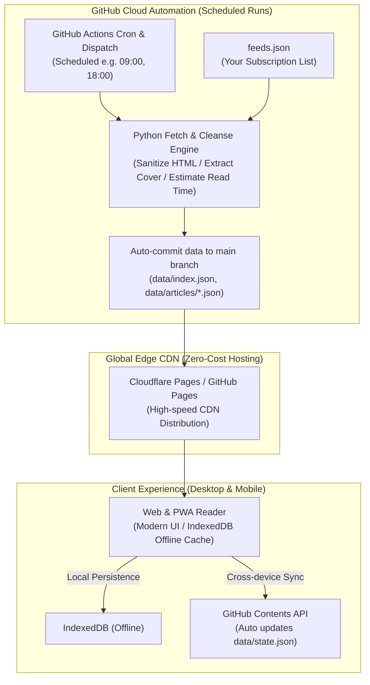

<div align="center">

# ⚡ GitFeed

**An Open-Source Serverless RSS Reader Using a Single Git Repository as Complete Backend & Database**

[](LICENSE)
[](.github/workflows/update-feeds.yml)
[](https://github.com/codeusb/gitfeed/releases/latest)
[](web/)
[](#)

**English** | [简体中文](README.md)

</div>

---

## 🌟 Why GitFeed?

Self-hosting traditional RSS readers (such as FreshRSS, Miniflux, or Tiny Tiny RSS) typically requires renting a VPS, maintaining Docker containers, and managing a PostgreSQL database. This incurs recurring monthly server costs, SSL renewals, and backup worries.

**GitFeed embraces the elegant "Git-as-Backend" serverless architecture:**

* 🚀 **$0 Recurring Cost**: No VPS, no database hosting fees. A single GitHub repository powers automated crawling, static JSON storage, and frontend hosting.
* 🌐 **Reliable Cloud Crawling**: GitHub Actions runners fetch feeds (Substack, Changelog, Medium, GitHub Blog, newsletters) on Azure's global network, bypassing local network latency and ISP connection issues.
* 📱 **Native-Grade PWA Client**: Built with React, Vite, and Tailwind CSS. Install it directly from your browser on iOS, Android, macOS, and Windows with a single click—enjoying full-screen reading without browser chrome.
* ⚡ **Global CDN Delivery**: Static pages and article JSONs are distributed via **Cloudflare Pages / GitHub Pages**, ensuring sub-100ms load times worldwide.
* 🔄 **Multi-Device Sync (Git-as-Backend)**: Local-first persistence (IndexedDB) with optional GitHub REST API state synchronization (`data/state.json`) using an append-only Set Union strategy—never losing read or starred items across devices.
* 🛠️ **Zero Maintenance**: As an end user, **you only maintain a single `feeds.json` configuration file**. Everything else is 100% automated!

---

## 🏗️ Architecture Overview



---

## 🚀 Quickstart: Build Your Private GitFeed from a Fork

No server required, no database needed. Follow these steps to fork GitFeed and launch your personal, full-platform RSS service in about 3 minutes!

### Step 1: Fork This Repository
1. Click the **`Fork`** button at the top right of this repository.
2. Select your personal GitHub account, keep the repository name as `gitfeed` (or customize it), and click **Create fork**.

### Step 2: Enable GitHub Actions Workflows
> [!IMPORTANT]
> GitHub automatically disables Actions workflows on all forked repositories by default for security reasons. You must manually enable them once.

1. In your forked repository, navigate to the **Actions** tab at the top.
2. Click the green button: **"I understand my workflows, go ahead and enable them"**.

### Step 3: Grant Workflow Write Permissions
Since GitHub Actions automatically commits fetched and sanitized articles back into your repository:
1. Go to your repository's **Settings** -> select **Actions** -> **General** on the left menu.
2. Scroll down to the **Workflow permissions** section.
3. Select **Read and write permissions**.
4. Check **Allow GitHub Actions to create and approve pull requests**.
5. Click **Save**.

### Step 4: Enable Free GitHub Pages Hosting
1. Go to **Settings** -> select **Pages** from the left navigation.
2. Under **Build and deployment**, set **Source** to **`GitHub Actions`**.
   *(Note: Do NOT choose Deploy from a branch; choose GitHub Actions)*.

### Step 5: Trigger Your Initial Crawl & Deployment
1. Go to the **Actions** tab.
2. In the left workflow list, click **`Update Feeds & Deploy`**.
3. Click the **`Run workflow`** dropdown on the right -> keep `Branch: main` -> click the green **Run workflow** button.
4. Wait about 1-2 minutes. The workflow will fetch default feeds, sanitize articles into static JSON, and deploy your site to GitHub Pages.
5. Once finished, visit your live reader at:
   ```
   https://<your-github-username>.github.io/gitfeed/
   ```
   Your private cloud RSS reader is now live! It will automatically update silently twice a day via GitHub Actions.

---

### Step 6: Multi-Device Sync Configuration (Web + Mobile)

GitFeed uses a local-first architecture. It functions with offline caching even without any token. To seamlessly sync read and starred statuses between **Desktop Web** and **Mobile App (Android APK / iOS PWA)**:

1. **Generate a GitHub Personal Access Token (PAT)**:
   * Go to GitHub -> Click your profile avatar -> **Settings** -> **Developer settings** -> **Personal access tokens** -> **Fine-grained tokens**.
   * Click **Generate new token**:
     * **Token name**: e.g., `gitfeed-sync`;
     * **Repository access**: Select **Only select repositories** -> pick your `gitfeed` repository;
     * **Permissions**: Expand **Repository permissions**, find **Contents**, and set to **Read and write**;
   * Click **Generate token** at the bottom and copy the token string (`github_pat_...`).
2. **Configure Clients for Sync**:
   * Open your GitFeed Web reader or Mobile App, and tap the **⚙️ Settings** icon:
     * **Data Source URL**: `https://<your-github-username>.github.io/gitfeed/data`
     * **GitHub Repository (username/repo)**: `<your-github-username>/gitfeed`
     * **GitHub Token**: Paste your generated PAT
     * Tap **"Sync Remote State"**
   * Both clients now feature debounced background synchronization and automatic HTTP 409 conflict resolution. Reading on one device will automatically sync to your other device upon launch or refresh!

> [!IMPORTANT]
> **Key Notes for Multi-Device Sync**:
> 1. **GitHub Repository (username/repo): Must be IDENTICAL on all clients!**
>    * For example, both Web and Mobile must be configured with: `codeusb/gitfeed`.
>    * **Why**: GitFeed uses a Git-as-Backend architecture where read and starred states are persisted in `data/state.json` inside that specific repository. If the repository names differ or are left blank, they will not point to the same state file and synchronization will fail.
> 2. **GitHub Personal Access Token (PAT): Use the EXACT SAME token on all devices!**
>    * As long as the PAT has `contents:write` access to your repository, both Web and Android can share the same token. There is no need to generate separate tokens.
> 3. **Automatic Bidirectional Background Sync**:
>    * Once configured, opening the app, pulling to refresh, reading articles, or starring items will automatically synchronize silently in the background. You do not need to manually click "Sync" every time.

---

### Step 7: Get Mobile & Desktop Apps

* 📱 **Android Native App**:
  * **Direct Download**: Grab the latest pre-compiled `GitFeed-vx.x.x.apk` from the [Releases Page](https://github.com/codeusb/gitfeed/releases/latest).
  * **Cloud Build for Yourself**: In your forked repository, go to **Actions** -> select **`Build & Release Android APK`** -> click **Run workflow**. GitHub will automatically build a release APK under your own repository's Releases.
* 🍎 **iOS (iPhone / iPad)**:
  * Open your GitFeed URL in Safari, tap the bottom "Share" icon -> select **"Add to Home Screen"** for a full-screen, standalone app experience.
* 💻 **Mac / Windows Desktop**:
  * In Chrome or Edge, click the **"Install GitFeed"** icon in the address bar to install a standalone desktop application with complete keyboard navigation (`J`, `K`, `M`, `S`).

---

### Step 8: Customize Your Subscriptions & Theme

* **Manage RSS Subscriptions**:
  * Directly edit `feeds.json` in your repository root via the GitHub web editor to add blogs, newsletters, and podcasts.
  * Or import your existing OPML subscription file exported from Feedly / Inoreader directly in the Web reader's Settings.
* **Unified Design Token Customization**:
  * GitFeed features the minimalist Astryx design system with a Single Source of Truth architecture.
  * To customize colors or add custom palettes, modify `shared/tokens.json` and run `npm run tokens:gen` to update both Web and Mobile synchronously!

---

## 📲 Mobile & Desktop Apps (Android Native APK & PWA)

GitFeed provides two frontend experiences: a modern responsive Web PWA and a **native React Native Android App (APK)**.

### 🤖 Android Native App (React Native APK)
You can download the sideloadable APK directly from GitHub Releases without going through app stores:
* 📥 **[Download Latest APK from GitHub Releases](https://github.com/codeusb/gitfeed/releases/latest)**
* **Features**:
  * Native 120Hz smooth scrolling and haptic touch feedback.
  * Robust offline cache (AsyncStorage / local database)—read cached articles without an active internet connection.
  * GitHub API multi-device read & starred state sync.
  * **In-app self-update checker**: tap "Check for Updates" in Settings to directly download newer APK releases.
* **Automated Cloud Build & Release**:
  Simply push a Git version tag to trigger the cloud compilation and release workflow:
  ```bash
  git tag v1.0.0
  git push origin v1.0.0
  ```
  *(Or click `Run workflow` manually under the `Build & Release Android APK` tab in GitHub Actions)*.

### 📱 Mobile PWA (iOS / Android)
* **iOS (Safari)**: Open your GitFeed URL in Safari -> Tap the **Share** button -> Tap **"Add to Home Screen"**. GitFeed launches in standalone mode with offline support.
* **Android (Chrome / Edge)**: Open the URL -> Tap the menu -> Tap **"Install App"** or **"Add to Home Screen"**.

### 💻 Desktop (macOS / Windows / Linux)
* Open the site in Chrome, Edge, or Brave. Click the **Install** button on the address bar for an independent desktop app window.

---

## 📝 Managing Your RSS Feeds

You only need to edit `feeds.json` in the root directory:

### 1. Edit `feeds.json` Directly on GitHub
You can add or remove feeds directly in the GitHub web interface:

```json
{
  "categories": [
    {
      "id": "frontend",
      "name": "Frontend & Web",
      "icon": "code"
    }
  ],
  "feeds": [
    {
      "id": "github-blog",
      "title": "GitHub Blog",
      "url": "https://github.blog/feed/",
      "siteUrl": "https://github.blog",
      "category": "frontend",
      "enabled": true
    }
  ]
}
```

### 2. Import OPML from Feedly / Inoreader / NetNewsWire
Export an `.opml` file from your existing reader, place it in the project root, and run:

```bash
# Import your OPML subscription file (automatically deduplicates and merges categories)
python scripts/opml_tool.py import subscriptions.opml

# Export current subscriptions to standard OPML 2.0
python scripts/opml_tool.py export my_feeds.opml
```
*(You can also export OPML directly from the Feed Manager modal inside the web reader!)*

---

## ⚡ Global Speed Optimization via Cloudflare Pages

For users desiring maximum CDN speed without relying solely on `github.io`:

1. Sign up/log in to [Cloudflare Dashboard](https://dash.cloudflare.com/), go to **Workers & Pages** -> **Create application** -> **Pages** -> **Connect to Git**.
2. Authorize and select your `gitfeed` repository.
3. Build configuration:
   * **Framework preset**: `None` (or Vite)
   * **Build command**: `npm run build`
   * **Build output directory**: `web/dist`
4. Click **Save and Deploy**.
5. Cloudflare will deploy your site on its global anycast network (e.g. `https://gitfeed-xxx.pages.dev`).

---

## 🔄 Cross-Device Read State Sync (Optional)

If reading on a single device, read states are saved in local IndexedDB without any configuration.

To sync read and starred states between multiple devices (e.g. Mac + iPhone):
1. In GitHub, go to **Settings** -> **Developer settings** -> **Personal access tokens** -> **Fine-grained tokens**.
2. Click **Generate new token**:
   * **Repository access**: Select **Only select repositories** -> Choose your `gitfeed` repo.
   * **Permissions**: Under **Repository permissions**, find **Contents** and set to **Read and write**.
3. Copy the token. Open GitFeed on your device, click **Settings** (bottom left):
   * Enter your repo (e.g. `yourusername/gitfeed`)
   * Paste your token
   * Click **"Sync Reading State Now"**.

GitFeed uses a mathematical Set Union algorithm. Reading articles on different devices will seamlessly merge without conflicting or overwriting data.

---

## ⌨️ Keyboard Shortcuts

Power through your reading list on desktop with vim-style keyboard navigation:

| Shortcut | Description |
| :--- | :--- |
| <kbd>J</kbd> | Navigate to next article |
| <kbd>K</kbd> | Navigate to previous article |
| <kbd>M</kbd> | Toggle Read / Unread status |
| <kbd>S</kbd> | Toggle Star / Favorite |
| <kbd>O</kbd> or <kbd>V</kbd> | Open original article in a new tab |
| <kbd>/</kbd> | Focus instant search bar |
| <kbd>R</kbd> | Refresh feeds and trigger remote sync |
| <kbd>?</kbd> | Open keyboard shortcuts modal |
| <kbd>Esc</kbd> | Close modal or deselect current article |

---

## 💻 Local Development

To run or customize GitFeed locally:

```bash
# Clone the repository
git clone https://github.com/yourusername/gitfeed.git
cd gitfeed

# Install frontend dependencies
npm install

# Install Python crawler dependencies
pip install -r scripts/requirements.txt

# Manually fetch articles
npm run fetch

# Start local dev server with Hot Module Replacement (HMR)
npm run dev
```

Visit `http://localhost:3000` to view the app.

---

## 📂 Repository Structure

```text
gitfeed/
├── .github/workflows/
│   └── update-feeds.yml     # Scheduled cron crawl, git commit & Pages deployment
├── scripts/
│   ├── fetch.py             # Feed crawler & sanitizer (Python, BeautifulSoup, Feedparser)
│   ├── opml_tool.py         # Two-way OPML 2.0 import and export utility
│   └── requirements.txt     # Python requirements
├── feeds.json               # Primary user configuration file
├── data/                    # Static article database (Git-as-Backend)
│   ├── feeds.json           # Cached feed configuration
│   ├── index.json           # Lightweight article summaries for high-speed list rendering
│   ├── stats.json           # Crawl statistics and feed health monitoring
│   └── articles/            # Full sanitized article JSON files & media attachments
├── web/                     # Modern Web & PWA source code
│   ├── public/              # PWA manifest, service worker, icons
│   └── src/
│       ├── components/      # Sidebar, ArticleList, ReaderView, Settings, etc.
│       ├── db/              # IndexedDB local-first storage
│       └── services/        # Data loader and GitHub Contents REST API sync service
├── wrangler.toml            # Cloudflare Pages configuration
├── vercel.json              # Vercel configuration
├── package.json             # Root helper scripts
└── LICENSE                  # MIT License
```

---

## 📄 License

Distributed under the [MIT License](LICENSE). Feel free to fork, adapt, and build upon GitFeed!
