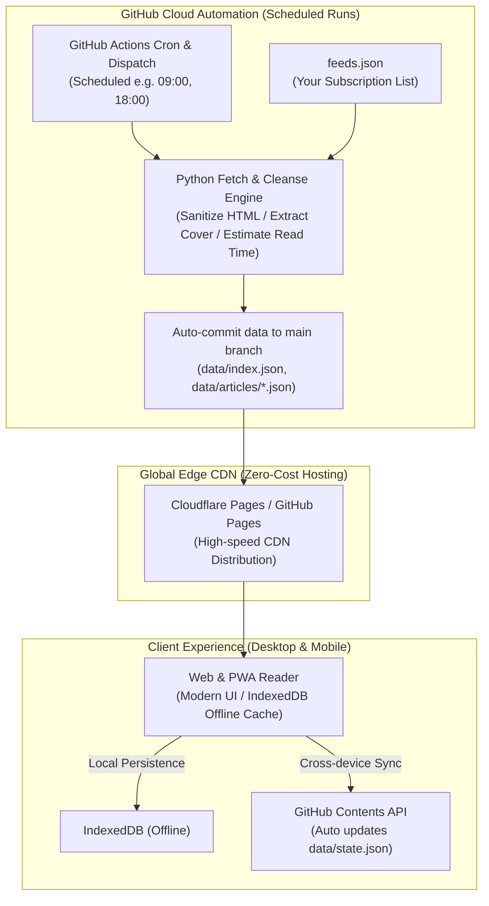

<div align="center">

# ⚡ GitFeed

**An Open-Source Serverless RSS Reader Using a Single Git Repository as Complete Backend & Database**

[](LICENSE)
[](.github/workflows/update-feeds.yml)
[](web/)
[](#)

**English** | [简体中文](README.md)

</div>

---

## 🌟 Why GitFeed?

Self-hosting traditional RSS readers (such as FreshRSS, Miniflux, or Tiny Tiny RSS) typically requires renting a VPS, maintaining Docker containers, and managing a PostgreSQL database. This incurs recurring monthly server costs, SSL renewals, and backup worries.

**GitFeed embraces the elegant "Git-as-Backend" serverless architecture:**

* 🚀 **$0 Recurring Cost**: No VPS, no database hosting fees. A single GitHub repository powers automated crawling, static JSON storage, and frontend hosting.
* 🌐 **Reliable Cloud Crawling**: GitHub Actions runners fetch feeds (Substack, Changelog, Medium, GitHub Blog, newsletters) on Azure's global network, bypassing local network latency and ISP connection issues.
* 📱 **Native-Grade PWA Client**: Built with React, Vite, and Tailwind CSS. Install it directly from your browser on iOS, Android, macOS, and Windows with a single click—enjoying full-screen reading without browser chrome.
* ⚡ **Global CDN Delivery**: Static pages and article JSONs are distributed via **Cloudflare Pages / GitHub Pages**, ensuring sub-100ms load times worldwide.
* 🔄 **Multi-Device Sync (Git-as-Backend)**: Local-first persistence (IndexedDB) with optional GitHub REST API state synchronization (`data/state.json`) using an append-only Set Union strategy—never losing read or starred items across devices.
* 🛠️ **Zero Maintenance**: As an end user, **you only maintain a single `feeds.json` configuration file**. Everything else is 100% automated!

---

## 🏗️ Architecture Overview



---

## 🚀 3-Minute Quickstart

Get your own private RSS reader running in 3 simple steps:

### Step 1: Fork This Repository
Click the **`Fork`** button at the top right of this repository to create a copy under your personal GitHub account.

### Step 2: Grant Workflow Read & Write Permissions
Since GitHub Actions automatically commits fetched feed data back into your repository:
1. In your forked repository, go to **Settings** -> **Actions** -> **General**.
2. Scroll to the bottom under **Workflow permissions**, choose **Read and write permissions**.
3. Click **Save**.

### Step 3: Enable GitHub Pages Deployment
1. Go to **Settings** -> **Pages**.
2. Under **Build and deployment** -> **Source**, select **`GitHub Actions`**.
3. Switch to the **Actions** tab, select **`Update Feeds & Deploy`** on the left, and click **`Run workflow`** to trigger the initial crawl and deployment.
4. Once completed (approx. 1-2 minutes), refresh your Pages tab to find your live GitFeed URL (e.g. `https://yourusername.github.io/gitfeed/`)!

---

## 📲 Installing as a PWA (Mobile & Desktop)

GitFeed is a high-performance Progressive Web App (PWA):

### 📱 Mobile (iPhone / Android)
* **iOS (Safari)**: Open your GitFeed URL in Safari -> Tap the **Share** button -> Tap **"Add to Home Screen"**. GitFeed will launch as a standalone, distraction-free app with offline support.
* **Android (Chrome / Edge)**: Open the URL -> Tap the menu (three dots) -> Tap **"Install App"** or **"Add to Home Screen"**.

### 💻 Desktop (macOS / Windows / Linux)
* Open the site in Chrome, Edge, or Brave. Click the **Install** button on the right side of the address bar to create a native standalone application window with full keyboard shortcut support.

---

## 📝 Managing Your RSS Feeds

You only need to edit `feeds.json` in the root directory:

### 1. Edit `feeds.json` Directly on GitHub
You can add or remove feeds directly in the GitHub web interface:

```json
{
  "categories": [
    {
      "id": "frontend",
      "name": "Frontend & Web",
      "icon": "code"
    }
  ],
  "feeds": [
    {
      "id": "github-blog",
      "title": "GitHub Blog",
      "url": "https://github.blog/feed/",
      "siteUrl": "https://github.blog",
      "category": "frontend",
      "enabled": true
    }
  ]
}
```

### 2. Import OPML from Feedly / Inoreader / NetNewsWire
Export an `.opml` file from your existing reader, place it in the project root, and run:

```bash
# Import your OPML subscription file (automatically deduplicates and merges categories)
python scripts/opml_tool.py import subscriptions.opml

# Export current subscriptions to standard OPML 2.0
python scripts/opml_tool.py export my_feeds.opml
```
*(You can also export OPML directly from the Feed Manager modal inside the web reader!)*

---

## ⚡ Global Speed Optimization via Cloudflare Pages

For users desiring maximum CDN speed without relying solely on `github.io`:

1. Sign up/log in to [Cloudflare Dashboard](https://dash.cloudflare.com/), go to **Workers & Pages** -> **Create application** -> **Pages** -> **Connect to Git**.
2. Authorize and select your `gitfeed` repository.
3. Build configuration:
   * **Framework preset**: `None` (or Vite)
   * **Build command**: `npm run build`
   * **Build output directory**: `web/dist`
4. Click **Save and Deploy**.
5. Cloudflare will deploy your site on its global anycast network (e.g. `https://gitfeed-xxx.pages.dev`).

---

## 🔄 Cross-Device Read State Sync (Optional)

If reading on a single device, read states are saved in local IndexedDB without any configuration.

To sync read and starred states between multiple devices (e.g. Mac + iPhone):
1. In GitHub, go to **Settings** -> **Developer settings** -> **Personal access tokens** -> **Fine-grained tokens**.
2. Click **Generate new token**:
   * **Repository access**: Select **Only select repositories** -> Choose your `gitfeed` repo.
   * **Permissions**: Under **Repository permissions**, find **Contents** and set to **Read and write**.
3. Copy the token. Open GitFeed on your device, click **Settings** (bottom left):
   * Enter your repo (e.g. `yourusername/gitfeed`)
   * Paste your token
   * Click **"Sync Reading State Now"**.

GitFeed uses a mathematical Set Union algorithm. Reading articles on different devices will seamlessly merge without conflicting or overwriting data.

---

## ⌨️ Keyboard Shortcuts

Power through your reading list on desktop with vim-style keyboard navigation:

| Shortcut | Description |
| :--- | :--- |
| <kbd>J</kbd> | Navigate to next article |
| <kbd>K</kbd> | Navigate to previous article |
| <kbd>M</kbd> | Toggle Read / Unread status |
| <kbd>S</kbd> | Toggle Star / Favorite |
| <kbd>O</kbd> or <kbd>V</kbd> | Open original article in a new tab |
| <kbd>/</kbd> | Focus instant search bar |
| <kbd>R</kbd> | Refresh feeds and trigger remote sync |
| <kbd>?</kbd> | Open keyboard shortcuts modal |
| <kbd>Esc</kbd> | Close modal or deselect current article |

---

## 💻 Local Development

To run or customize GitFeed locally:

```bash
# Clone the repository
git clone https://github.com/yourusername/gitfeed.git
cd gitfeed

# Install frontend dependencies
npm install

# Install Python crawler dependencies
pip install -r scripts/requirements.txt

# Manually fetch articles
npm run fetch

# Start local dev server with Hot Module Replacement (HMR)
npm run dev
```

Visit `http://localhost:3000` to view the app.

---

## 📂 Repository Structure

```text
gitfeed/
├── .github/workflows/
│   └── update-feeds.yml     # Scheduled cron crawl, git commit & Pages deployment
├── scripts/
│   ├── fetch.py             # Feed crawler & sanitizer (Python, BeautifulSoup, Feedparser)
│   ├── opml_tool.py         # Two-way OPML 2.0 import and export utility
│   └── requirements.txt     # Python requirements
├── feeds.json               # Primary user configuration file
├── data/                    # Static article database (Git-as-Backend)
│   ├── feeds.json           # Cached feed configuration
│   ├── index.json           # Lightweight article summaries for high-speed list rendering
│   ├── stats.json           # Crawl statistics and feed health monitoring
│   └── articles/            # Full sanitized article JSON files & media attachments
├── web/                     # Modern Web & PWA source code
│   ├── public/              # PWA manifest, service worker, icons
│   └── src/
│       ├── components/      # Sidebar, ArticleList, ReaderView, Settings, etc.
│       ├── db/              # IndexedDB local-first storage
│       └── services/        # Data loader and GitHub Contents REST API sync service
├── wrangler.toml            # Cloudflare Pages configuration
├── vercel.json              # Vercel configuration
├── package.json             # Root helper scripts
└── LICENSE                  # MIT License
```

---

## 📄 License

Distributed under the [MIT License](LICENSE). Feel free to fork, adapt, and build upon GitFeed!
